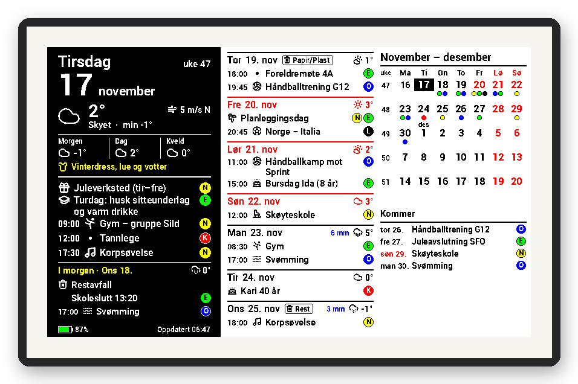
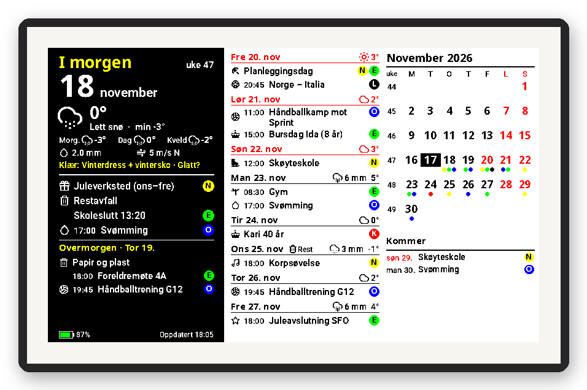
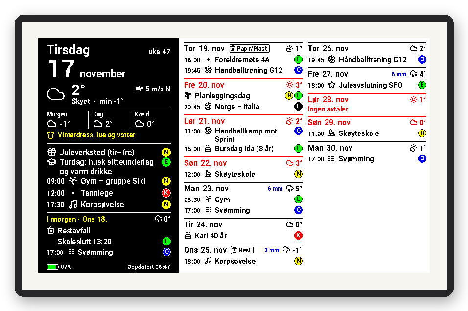
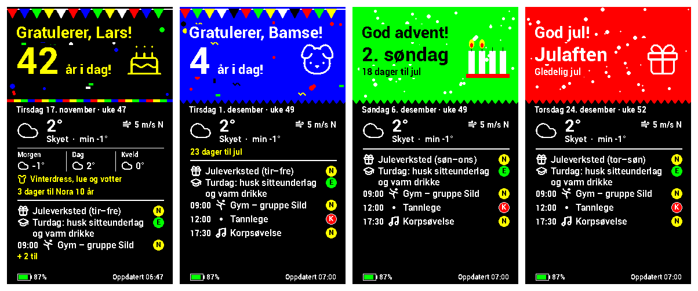
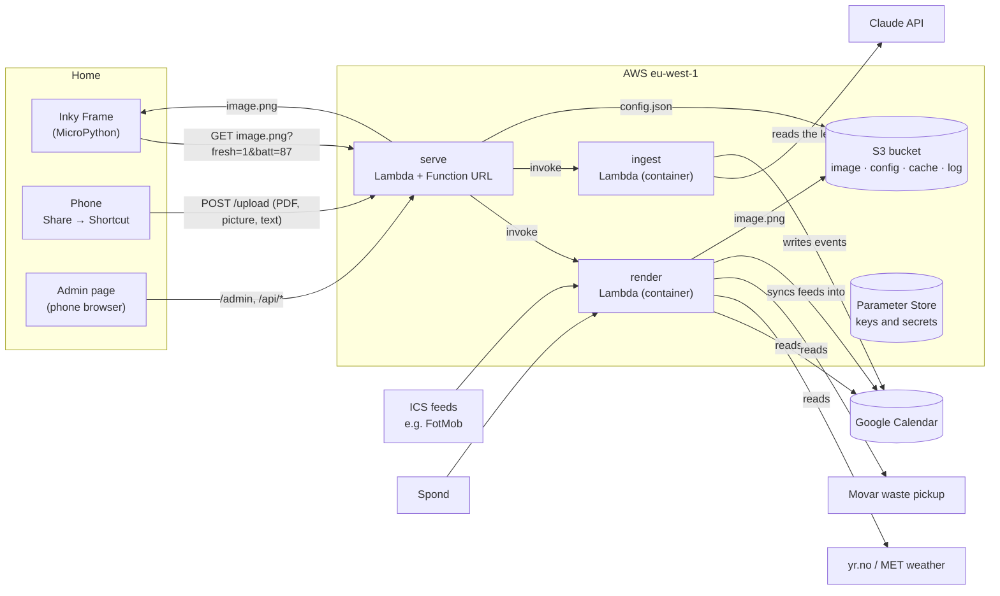
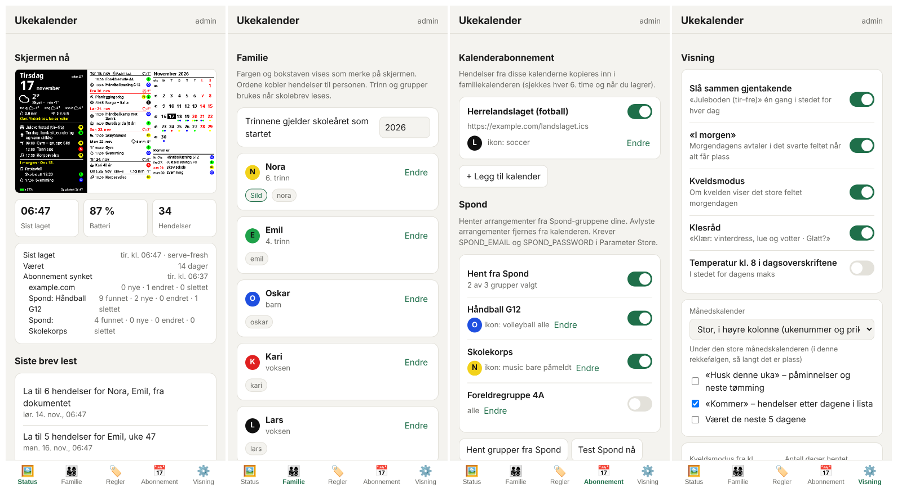

# Ukekalender: a family calendar on e-ink

A battery-powered e-ink calendar for the kitchen wall. It shows the family's next two weeks: who has what, the weather, waste pickup and days off from school. It costs a few kroner a month to run.

The frame wakes up twice a day, fetches one ready-made picture and goes back to sleep. Everything else happens in a small AWS backend:
- it merges your Google Calendar with weather, waste pickup, sports schedules and Spond;
- it reads school letters you share from your phone with Claude and puts the events in the calendar;
- it draws the picture.

Settings are managed from a web page on your phone.



*All screenshots use a made-up family (Nora, Emil, Oskar, Kari and Lars) and made-up events. They are rendered by the real design code: `python docs/mockups/make_mockups.py`.*

---

## Contents

- [What it shows](#what-it-shows)
- [Hardware](#hardware)
- [How it works](#how-it-works)
- [Setting it up](#setting-it-up)
  - [1. AWS backend](#1-aws-backend)
  - [2. Google Calendar](#2-google-calendar)
  - [3. Settings in Parameter Store](#3-settings-in-parameter-store)
  - [4. The frame](#4-the-frame)
  - [5. The admin page](#5-the-admin-page)
  - [6. Send school letters from your phone](#6-send-school-letters-from-your-phone)
  - [7. Sports schedules and Spond](#7-sports-schedules-and-spond)
  - [8. Alerts](#8-alerts)
- [Display options](#display-options)
- [Costs](#costs)
- [Security](#security)
- [Development](#development)
- [Repository layout](#repository-layout)

---

## What it shows

**Morning (the 04:00 update)**

- **The black panel** is today: the date, week number, today's weather and the morning, day and evening temperature, plus clothing advice ("Klær: vinterdress, lue og votter · Glatt?"). Below that come all of today's events. If they fit, tomorrow's events are shown too ("I morgen").
- **The middle column** is the coming days. Each day has its weather, waste pickup (bin icon) and events. Every event carries coloured badges showing who it is for. Days with nothing on say "Ingen avtaler". Red days are weekends, public holidays and days off from school.
- **The right column** is a large month calendar with week numbers. A coloured dot under a date means someone has something that day. Below it, "Kommer" lists what follows after the days shown.

**Evening (the 17:30 update)**

After 17:00 the big panel switches to **tomorrow** ("I morgen"), with tomorrow's weather and clothing advice. Anything still left today is shown as "I kveld".



**Other features**

- **Shortened repeats:** an all-day event that repeats is shown once, as "Juleverksted (tir–fre)", instead of on every day.
- **Days off:** red dates. Norwegian public holidays (with a flag) are calculated in code every year, Easter and Pentecost included; julaften and nyttårsaften can be switched on or off on the admin page. School holidays and days off (with a beach umbrella) come from the school calendar you send in (see [school letters](#6-send-school-letters-from-your-phone)).
- **Battery level:** shown in the corner. The frame measures it and sends it along with its next request.
- **Birthdays and special days:** see below.
- **Layouts:** different layouts can be chosen on the admin page. For example, here the month calendar is replaced by more days:



**Birthdays and special days**

On a birthday the top of the black panel becomes a tall banner in that person's colour, with flags, confetti, the age and a cake (or a dog for the dog). Someone whose colour is black gets gold text and a rainbow edge. Holidays get their own themes:



| Occasion | Banner |
|---|---|
| Birthday | "Gratulerer, Nora! 10 år i dag!" in the person's colour; birthdays are set per person on the admin page |
| Christmas | Julaften, 1. and 2. juledag and romjul: red with snow; Juleferie: "Dag 4 av 12" |
| New Year | Nyttårsaften and 1. januar: blue with fireworks |
| Advent | The four Sundays: green with candles, one more lit each week, and "18 dager til jul" |
| Easter | Skjærtorsdag to 2. påskedag and påskeferie: yellow with Easter eggs |
| 17. mai | Red with flags: "Hipp hurra!" |
| School holidays | Vinter-, sommer- and høstferie with their own decorations and "Dag 2 av 5" |
| Days off | Planleggingsdag and other days off: "Fri i dag! Nora og Emil har fri" |
| Other days | Morsdag, farsdag, fastelavn, Lucia, Sankthans and Halloween |
| Match day | A fixture from a calendar feed: "Kampdag! 20:45" |
| Name day / yearly dates | "Gratulerer, Emil! Navnedag" and your own dates such as "Bryllupsdag! 14 år i dag" (set on the admin page) |
| First snow | "Første snø!" the first morning of the season with snow in the forecast |
| Weather warning | MET Norway's farevarsler for your location: orange and red get the banner ("Farevarsel! Styrtregn"), yellow a line ("Gult farevarsel: Kuling til kl 18 – sikre løse ting ute"). A red warning beats everything, an orange one everything except a birthday. |

Small yellow lines under the weather add:
- countdowns, such as "3 dager til Nora 10 år", "4 dager til høstferie" and "14 dager til jul";
- "Morsdag i morgen!" and "Klokka stilles tilbake en time i natt";
- "Fint vær i helga" on a sunny Friday;
- the dinner question from the week's school letter ("Middagsspørsmål: …") in the evening;
- "Svar på Spond: Kamp lør 11:00 (Oskar)" when someone in the family has not answered a Spond invitation;
- countdowns to your own events: put ⏳ in an event's title in Google Calendar ("⏳ Syden") and the frame counts down to it ("64 dager til Syden");
- "Fullmåne i natt" and "Nordlys mulig i kveld (Kp 6)" (NOAA's forecast).

With a Tibber token, the **evening view** shows "Strøm og bil" under the month calendar instead of "Kommer": electricity for the last 30 days compared with the same days last year (−11 %), as a bar chart, and the car's battery when it is available; the car's % is also shown next to the frame's battery. When there is room, it also shows the electricity cost so far this year and an estimate for the whole year, at the Norgespris rate (50 øre/kWh incl. VAT up to 5 000 kWh per month, spot price above; set in `NORGESPRIS` in `aws_lambda/tibber.py`). It also adds Elvia's nettleie, from Tibber's hourly data: the energy part at day rate (weekdays 06–22) or night/weekend rate, and the monthly capacity step from the average of the month's three highest daily peak hours. The rates are in `TARIFFS` in `aws_lambda/nettleie.py`; add a row when Elvia publishes new prices. If the hourly data isn't available, the box shows the cost without nettleie and says so. Tibber's monthly fee is not included. The rest of the year is estimated from last year's consumption on the same dates, with the last 30 days' day/night split and peaks.

The month column can also show **"Denne uka"**: chores that rotate weekly between the people you pick ("Oppvask: Emil · Søppel: Nora"). When the battery is below 15 %, the frame shows "Bytt batteri!".

All of this can be switched off on the admin page.

---

## Hardware

| Part | Notes |
|---|---|
| **Pimoroni Inky Frame 7.3" (Pico 2 W aboard)** | The display itself. It is 800 × 480 pixels, uses Spectra 6 colour e-ink (black, white, red, yellow, green, blue), and has a Raspberry Pi Pico 2 W, a real-time clock, five buttons and a microSD slot. The image stays on screen with no power. [Pimoroni shop page](https://shop.pimoroni.com/products/inky-frame-7-3) |
| **Inky Frame accessory kit** (recommended) | For the 7.3" this kit has two metal legs to stand the frame up, a 3 × AA battery pack with a JST-PH plug and AA batteries, a USB cable, a Velcro square for the battery pack, and a microSD card. Check the listing for your model, since the contents vary a little. |
| **Power** | Either the 3 × AA pack or a single-cell LiPo with its own protection circuit. Inky Frame has no battery protection, so the LiPo must have it built in. On USB power the frame can't switch itself fully off between updates. The battery percentage on screen is calculated for a LiPo (4.2 V full, 3.2 V empty), so with AA batteries it is only a rough guide. |
| **A USB cable to your computer** | Needed once, to install the code with Thonny. |
| **2.4 GHz Wi-Fi** | The Pico 2 W can't use 5 GHz networks. |

Nothing else is needed: there is no server at home, the backend runs in AWS.

---

## How it works



1. **The frame**, at 04:00, at 17:30 or when a button is pressed:
   - it connects to Wi-Fi and requests `image.png?token=…&fresh=1&batt=87`;
   - it saves the PNG to flash memory, shows it, and sleeps until the next update time.
   - If something fails, it keeps the last picture and draws a small error note on top. It never shows a blank screen.
2. **serve** checks the token, starts **render** and waits up to about 55 seconds for the new picture. If render takes too long, it returns the previous picture.
3. **render** does the following:
   - reads the settings from the admin page (`config/config.json`);
   - copies subscribed calendars (ICS feeds and Spond) into the family calendar, at most every 6 hours;
   - fetches events, weather and waste pickup;
   - maps names to coloured badges and keywords to icons;
   - draws the picture with the chosen design and stores it in S3.
4. **ingest** runs when you share a document from your phone:
   - Claude reads it (PDF, picture, text or web page) together with the family's existing calendar;
   - Claude picks out what parents need to know: "Husk …", meetings, deadlines, days off, early finishes, trips, gym days and special events;
   - ingest writes those events into Google Calendar, with the child's name at the end of the title, so they appear on the frame and on everyone's phones.

---

## Setting it up

You need:
- an AWS account;
- a Google account, owning the family calendar;
- a GitHub fork of this repository;
- an Anthropic API key, for the school letters.

Allow about an hour.

### 1. AWS backend

The full step-by-step guide is in **[infra/README.md](infra/README.md)**. In short:

1. **Create the AWS account:** create it, turn on MFA, and set up a budget alarm, for example $5 a month.
2. **Let GitHub deploy:** in CloudFormation, create a stack from `infra/bootstrap.yaml` (named `weekcalendar-bootstrap`). It creates a deploy role that only GitHub Actions on your `main` branch can use, through OIDC, so no AWS keys are stored in GitHub. Store the role's ARN as the repository variable `AWS_DEPLOY_ROLE_ARN`.
3. **Push to `main`:** the workflow `.github/workflows/deploy-aws.yml` runs the tests and deploys the `weekcalendar` stack with `sam deploy`. The stack contains three Lambda functions, the S3 bucket and IAM roles. The output **`FunctionUrl`** is your address, `https://<id>.lambda-url.eu-west-1.on.aws/`.

Every later push to `main` deploys again automatically.

### 2. Google Calendar

The system uses **one family calendar** in Google Calendar, with two kinds of access:

| What | Used for | How |
|---|---|---|
| **API key** (`API_KEY_GOOGLE`) | Reading events for the picture | In Google Cloud Console, create an API key restricted to the Google Calendar API. An API key can only read calendars that are public, so the family calendar must be shared publicly ("Make available to public"). The calendar ID is long and random, but anyone who has it can read the calendar. |
| **Service account** (`GOOGLE_SA_JSON`) | Writing events from school letters, feeds and Spond | In Google Cloud Console, enable the **Google Calendar API**, create a service account and download a JSON key. In Google Calendar, share the family calendar with the service account's e-mail address and give it **"Make changes to events"**. |

`CALENDAR_ID` is the calendar's ID: Google Calendar → Settings → the calendar → "Integrate calendar", ending in `@group.calendar.google.com`.

### 3. Settings in Parameter Store

All keys and secrets are stored in **AWS Systems Manager → Parameter Store** (region eu-west-1), under `/weekcalendar/`. Use **SecureString** for anything secret. Paste values into the console or CloudShell yourself; never put them in a file in the repository.

| Parameter | Required | What it is |
|---|---|---|
| `FRAME_TOKEN` | yes | A long random string (`openssl rand -hex 24`). The frame and the phone shortcut send it to prove who they are. |
| `ADMIN_TOKEN` | yes | A different long random string. It is the password for the admin page. |
| `API_KEY_GOOGLE`, `CALENDAR_ID` | yes | See [Google Calendar](#2-google-calendar). |
| `GOOGLE_SA_JSON` | for writing | The full JSON key file of the service account. |
| `ANTHROPIC_API_KEY` | for school letters | An Anthropic API key from [console.anthropic.com](https://console.anthropic.com). |
| `LAT`, `LON` | recommended | Your location, used for the weather from [MET Norway / yr.no](https://api.met.no). |
| `MOVAR_API_TOKEN`, `MOVAR_BASE`, `KOMMUNENR`, `MOVAR_GATENAVN`, `MOVAR_HUSNR` | optional | Waste pickup dates (Movar). Leave them out if your area is served by another company. |
| `SPOND_EMAIL`, `SPOND_PASSWORD` | optional | Your Spond login, for [Spond](#7-sports-schedules-and-spond). The account must have a password; sign-in with Google or Apple alone won't work. |
| `TIBBER_TOKEN` | optional | Personal token from developer.tibber.com: household electricity (and the car, if Tibber provides it) in the evening view. |
| `NTFY_TOPIC` | optional | A long random topic name for push alerts (see [Alerts](#alerts)). |
| `OPENAI_API_KEY` | optional | Lets AI suggest icons for events that no keyword rule matches. |

### 4. The frame

1. **Connect the frame:** plug it into your computer with USB and install **[Thonny](https://thonny.org)**. Pimoroni's Inky Frame firmware comes with MicroPython; update it from [Pimoroni's releases](https://github.com/pimoroni/inky-frame) if it's old.
2. **Copy the code:** copy `frame/main.py` to the frame as `main.py`.
3. **Create the secrets file:** copy `frame/secrets_example.py` to the frame as **`secrets.py`** and fill it in:
   ```python
   WIFI_SSID = "your-network"
   WIFI_PASSWORD = "your-password"
   CALENDAR_URL = "https://<id>.lambda-url.eu-west-1.on.aws/image.png?token=<FRAME_TOKEN>&fresh=1"
   PRE_TRIGGER_URL = ""
   UPDATE_TIMES = ["04:00", "17:30"]   # local time; buttons also update
   ```
   Type the token directly into `secrets.py` on the frame. Never commit `secrets.py`; it is git-ignored.
4. **Disconnect and add power:** unplug the USB cable and connect the battery. The frame draws the first picture right away.

A few things to know about the frame:
- The Wi-Fi country is set to Norway (`rp2.country('NO')`). Power saving is turned off while connecting, which makes the connection more reliable.
- Reading the battery voltage uses a pin that is shared with the Wi-Fi chip. So the frame reads the battery only *after* Wi-Fi is finished, saves the value, sends it with the next request, and does a full restart after each sleep.

### 5. The admin page

Open `https://<id>.lambda-url.eu-west-1.on.aws/admin` on your phone and log in with `ADMIN_TOKEN`. The phone remembers the key. On an iPhone, Share → "Legg til på Hjem-skjerm" makes it look like an app.



| Tab | What you set there |
|---|---|
| **Status** | The picture currently on the frame; a preview of any date ("Forhåndsvis en dato", for example julaften or a birthday); when the frame last checked in; when it was made; battery level; how many events were found; one line per subscribed calendar or Spond group (found / new / changed / deleted, or the error); the last school letters read; a "Lag nytt bilde nå" button to make a new picture. |
| **Familie** | Each person's name, letter, colour, birthday, name day and the words that refer to them; the weekly rota ("Ukas oppgaver") and yearly dates ("Merkedager"). Pets can be added as type "dyr". For children, the school grade and groups ("gruppe Sild"), which help Claude work out who a letter is about. Grades are set for a school year and move up automatically every August. |
| **Regler** | Keyword rules, such as "korps" → music icon + Nora, or "middag:" → food icon. |
| **Abonnement** | Calendar feeds (any `.ics` address), Spond groups, and a clean-up tool for events left behind by other calendar syncs. |
| **Visning** | Layout options (see [Display options](#display-options)), birthdays and special days on or off, red public holidays (and julaften / nyttårsaften), when evening mode starts, how many days to fetch, and which AI model reads letters (Haiku, Sonnet or Opus). |

Every save keeps the previous version in `config/history/` in S3.

### 6. Send school letters from your phone

Weekly letters, flyers, invitations, the school's yearly calendar and screenshots all work the same way: share them to the calendar. Claude reads the document and also gets:
- the family's existing calendar, so it doesn't add events that are already there;
- the children's current grades and groups, so it knows who a letter is about.

| What's in the letter | What ends up in the calendar |
|---|---|
| "Husk foreldremøte tirsdag 18:00" | **Foreldremøte 4A Emil**, Tuesday 18:00 |
| "Fredag slutter vi 13:20" | **Skoleslutt 13:20 Emil**, Friday |
| "Vinterferie uke 8 (22.02–26.02)" | **Vinterferie Nora Emil**, one all-day event from 22.02 to 26.02, red with a beach umbrella |
| "Turdag onsdag – ta med sitteunderlag" | **Turdag – husk sitteunderlag Emil**, Wednesday |

Names go **last** in the title, so the keyword rules turn them into coloured badges. Dates that have already passed are skipped. Sending the same weekly letter again replaces that week's events instead of adding duplicates. The phone shows a reply such as "La til 5 hendelser for Emil, uke 47".

Accepted formats: PDF, JPEG, PNG, WebP, GIF, plain text, rich text and HTML. iPhone HEIC photos must be converted to JPEG first; the shortcut below does that.

**iPhone (the Shortcuts app):**
1. Create a new shortcut called "Til kalenderen". Under its settings, turn on **Show in Share Sheet** and accept files, images, PDFs, text and URLs.
2. If you send iPhone photos: add **Convert Image** to JPEG first, because HEIC is not accepted.
3. Add **Get Contents of URL**:
   - URL: `https://<id>.lambda-url.eu-west-1.on.aws/upload?token=<FRAME_TOKEN>`
   - Method: **POST**
   - Request body: **File**, set to the Shortcut Input.
4. Add **Show Result** (or **Show Notification**) with the contents of the URL, so you see Claude's reply.

**Android ([HTTP Shortcuts](https://http-shortcuts.rmy.ch/), free):**
1. Create a new shortcut and choose method **POST**.
2. URL: the same `…/upload?token=<FRAME_TOKEN>` address as above.
3. Request body: **File (from share)**.
4. Turn on **Show in share menu**, and show the response as a dialog.

On either phone you then share the document → "Til kalenderen".

### 7. Sports schedules and Spond

- **Calendar feeds:** on the **Abonnement** tab, add any `.ics` / `webcal://` address, for example a team's fixtures from FotMob or a Google calendar's "secret address in iCal format". Choose who the events are tagged with and an icon. Every 6 hours the events are copied into the family calendar. Changed kick-off times are updated, cancelled events are removed, and events the family has already added themselves are left alone.
- **Spond:**
  1. Add `SPOND_EMAIL` and `SPOND_PASSWORD` to Parameter Store.
  2. On the **Abonnement** tab, tap "Hent grupper fra Spond" and switch on the groups you want. For each group, choose who its events are tagged with, an icon, and whether to include **all events** or **only the ones you have said yes to**.
  3. Check that it works with "Test Spond nå".

  Cancelled or declined events are removed from the calendar at the next sync. This fixes the main problem with Spond's own calendar export, which leaves cancelled events behind. Spond has no official API, so this uses the same endpoints as Spond's app and could stop working if Spond changes them.

### 8. Alerts

A small function checks the frame every day at 12:00. If it has not fetched a picture for more than 26 hours (flat battery, Wi-Fi gone), or the battery it reported is below 15 %, you get a push notification on your phone:

1. Install the free **ntfy** app ([ntfy.sh](https://ntfy.sh), iPhone and Android).
2. Subscribe to a topic with a long random name, for example the output of `openssl rand -hex 12`. Anyone who knows the name can read the alerts, so treat it like a password.
3. Store the same name in Parameter Store as `/weekcalendar/NTFY_TOPIC`.

Each problem is reported once; the battery reminder at most every three days.

---

## Display options

Chosen on the **Visning** tab of the admin page. They can also be set as the `DesignOptions` stack parameter, with options joined by `+`.

| Option | Effect |
|---|---|
| `collapse` | Repeated all-day events are shown once, as "Juleverksted (tir–fre)". |
| `tomorrow` | Tomorrow's events appear in the black panel when everything fits. |
| `evening` | After `evening_hour` (default 17), the big panel shows tomorrow, plus anything left today as "I kveld". |
| `advice` | Clothing advice based on the temperature, precipitation and wind for the day. |
| `month_column` | A large month calendar with week numbers and person dots fills the right column. |
| `month` / `month_right` | A small month calendar, in the black panel or bottom right. |
| `upcoming` | Below the large month calendar: "Kommer", the events after the days shown. |
| `husk` | Below the month calendar: "Husk denne uka" reminders and the next waste pickup. |
| `weather5` | Below the month calendar: the weather for the next five days. |
| `morning` | Day headings show the 08:00 temperature instead of the day's maximum. |
| `moments` | Birthday and holiday banners, countdowns and small reminders (on by default; switch on the admin page). |

The default design is `dense`. The `designs/` folder also has `hero`, `agenda` and `band`, which can be chosen with the `Design` stack parameter.

---

## Costs

| | Per month |
|---|---|
| AWS: Lambda, S3, Parameter Store and logs | Fractions of a cent to a few cents. Two pictures a day fits easily in the free tier. |
| AWS: container image storage (ECR) | About $0.03. The deploy sets a rule that keeps only the 5 newest images. |
| Claude API: reading school letters | About 1 øre per letter with Haiku, roughly 20–50 øre with Sonnet, depending on the letter's length. |
| Weather (MET Norway), Google Calendar, Spond | Free. |
| **Total** | **About NOK 1–5 a month.** |

The hardware is a one-off purchase: the Inky Frame 7.3" and accessory kit, from Pimoroni or a reseller.

---

## Security

- **The Function URL is public, but every route checks a token.** The frame and upload routes use `FRAME_TOKEN`, and the admin routes use `ADMIN_TOKEN` (sent as the `X-Admin-Token` header). The comparison runs in constant time, so a token can't be guessed by measuring how long the check takes. Treat the full image address as a password, because it contains the token.
- **The S3 bucket is private** and only reachable over TLS. Each Lambda function has its own IAM role with the minimum access it needs.
- **Secrets live only in Parameter Store.** They are never in the repository, in GitHub, or in the frame's code except `secrets.py`, which stays on the frame.
- **Deploys use GitHub OIDC with short-lived credentials,** limited to the `main` branch. Protect `main` with branch protection.
- **School letters** are stored in S3 under `inbox/`. Claude sees them through the Anthropic API, and they are not used for model training.

---

## Development

```bash
pip install -r infra/requirements-lambda.txt boto3 "moto[s3,ssm]" pytest
pytest -q                                   # 100+ tests, no network or AWS needed
python docs/mockups/make_mockups.py         # re-render the README frame pictures
node docs/mockups/admin_shots.js            # re-take the admin screenshots (needs Playwright)
```

- **Designs:** each design is in `designs/<name>.py` and receives already-shaped data from `designs/adapter.py`, so it can be developed with mock data.
- **Tests:** the tests fake Google Calendar, Spond, S3 and SSM, so the whole pipeline can be tested offline.

**Line endings:** `main.py`, `data_provider.py`, `weather_provider.py` and `layout_renderer.py` use CRLF line endings, so keep them when editing.


---

## Repository layout

```
frame/                 MicroPython client for the Inky Frame (main.py, secrets_example.py)
aws_lambda/            Lambda handlers: serve (Function URL, admin API), render, ingest;
                       config_store.py (admin settings), spond_client.py, admin.html
school/                School letters: extract.py (Claude prompt + schema), calendar_sync.py,
                       feeds.py (ICS / Spond -> family calendar)
designs/               Image designs (dense, hero, agenda, band), adapter.py, common.py
data_provider.py       Fetches calendar, holidays, waste pickup and weather; keyword -> icon/badge mapping
weather_provider.py    MET Norway (yr.no) forecasts
main.py                Renders the picture (called by the render function)
infra/                 SAM template, Dockerfile, bootstrap stack, AWS setup guide
docs/                  README pictures and the scripts that make them
tests/                 pytest suite
```
